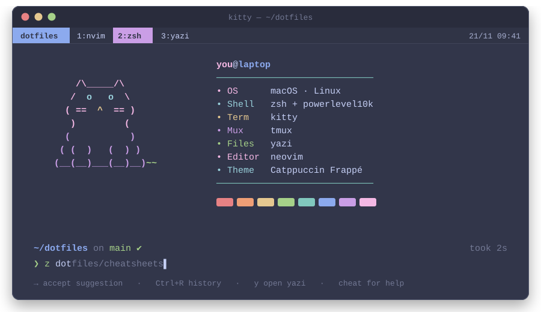
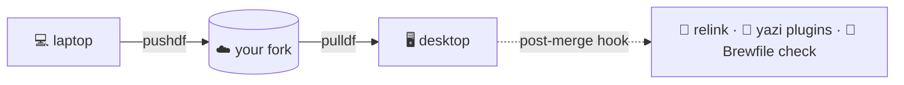

<a id="top"></a>

<div align="center">



<br>

<a href="#install"></a>
<a href="#install"></a>
<a href="https://github.com/catppuccin/catppuccin"></a>
<a href="LICENSE"></a>

<h3>
  <a href="#install">Install</a>
  <span> · </span>
  <a href="#inside">What's inside</a>
  <span> · </span>
  <a href="#cheat-codes">Cheat codes</a>
  <span> · </span>
  <a href="#make-it-yours">Make it yours</a>
  <span> · </span>
  <a href="cheatsheets/README.md">Cheatsheets</a>
</h3>

<br>



<br>
<br>

<p>
  <b>kitty</b> · <b>zsh</b> + <b>powerlevel10k</b> · <b>tmux</b> · <b>yazi</b> · <b>fzf</b> · <b>zoxide</b> · <b>neovim</b>
  <br>
  <sub>one palette · one command · zero secrets</sub>
</p>

</div>

<br>

## ✨ Highlights

<table>
<tr>
<td width="50%" valign="top">

### 🎨 One theme, everywhere
Catppuccin Frappé in kitty, tmux and yazi, with a Nerd Font so every icon just shows up.

</td>
<td width="50%" valign="top">

### 🐚 A shell that helps you
Grey autosuggestions from your history, live syntax highlighting, fuzzy `Ctrl+R`, and `z` to jump anywhere.

</td>
</tr>
<tr>
<td width="50%" valign="top">

### 📂 A file manager in the terminal
yazi previews images, video, PDFs, archives and rendered Markdown, with git status next to every file.

</td>
<td width="50%" valign="top">

### 🪟 tmux that feels obvious
`|` and `-` split, the mouse works, vim keys copy to your clipboard, and the bar lives on top.

</td>
</tr>
<tr>
<td width="50%" valign="top">

### 📚 Cheatsheets built in
Every tool comes with a one-page guide. Type `cheat` and you're never lost.

</td>
<td width="50%" valign="top">

### 🛟 Safe by design
Re-run the installer as often as you like. Anything in the way gets backed up, never deleted, and your secrets stay in `*.local` files that git ignores.

</td>
</tr>
</table>

<br>

<a id="install"></a>

## 🚀 Install

> [!NOTE]
> You need `git` and `curl`. On Linux, install `zsh` first: `sudo apt install zsh` or `sudo pacman -S zsh`.

```bash
git clone https://github.com/LifeOfAitor/dotfiles.git ~/dotfiles && ~/dotfiles/install.sh
```

That's it. Open a new terminal (or run `exec zsh`) and you're home.

> [!TIP]
> **Fork it first** and clone your fork. Then `pushdf` sends your tweaks to your own copy, and `pulldf` brings them to your other machines.

<details>
<summary><b>🔍 What does <code>install.sh</code> actually do?</b></summary>
<br>

| Step | What happens |
|:---:|---|
| 1 | Installs **Homebrew** if it's missing, then everything in the [`Brewfile`](Brewfile) |
| 2 | Installs **Oh My Zsh**, **Powerlevel10k** and five zsh plugins |
| 3 | Installs the **Nerd Fonts** the configs use (Meslo and JetBrainsMono) |
| 4 | **Symlinks** every config into `$HOME`, backing up what was there to `~/.dotfiles-backup/<date>/` |
| 5 | Enables the repo's **git hooks**, so each `git pull` re-applies everything |
| 6 | Installs the **yazi** plugins and asks for your **git name and email** (saved in `~/.gitconfig.local`) |

Every step skips what's already done, so it's safe to run again.

**Just the symlinks?** `./install.sh --links`
**Want a preview first?** `./scripts/link.sh -n` prints what it would change and changes nothing.

</details>

<details>
<summary><b>🧰 After installing</b></summary>
<br>

```bash
chsh -s "$(command -v zsh)"   # make zsh your default shell
gh auth login                 # let git push to GitHub through the gh CLI
p10k configure                # optional: design your own prompt
```

</details>

<br>

<a id="inside"></a>

## 📦 What's inside

```text
~/dotfiles
├── .zshrc                 zsh + Oh My Zsh + p10k, fzf, zoxide, eza, thefuck, the `y` function
├── .p10k.zsh              Powerlevel10k prompt
├── .tmux.conf             mouse, easy splits, vi copy mode, Catppuccin status bar
├── .gitconfig             rebase on pull, gh credentials, includes ~/.gitconfig.local
├── .vimrc                 a tiny fallback for plain Vim
├── .config/
│   ├── kitty/             Meslo Nerd Font, blurred translucent background, powerline tabs
│   ├── yazi/              only what differs from the defaults, plus four plugins
│   ├── neofetch/          an ASCII cat and a clean info layout
│   ├── htop/              process monitor layout
│   └── thefuck/           settings for `fuck`
├── Brewfile               every package the configs rely on
├── install.sh             the one command
├── scripts/
│   ├── link.sh            symlinks with backups (and a dry-run mode)
│   ├── update_dotfiles.sh `pushdf`
│   └── install-nerd-fonts.sh
├── .githooks/             re-apply the dotfiles after every pull
└── cheatsheets/           a one-page guide for every tool
```

<details>
<summary><b>🍺 Everything in the Brewfile</b></summary>
<br>

| Category | Packages |
|---|---|
| **Shell & terminal** | `zsh-autosuggestions` `zsh-syntax-highlighting` `eza` `bat` `fzf` `zoxide` `tmux` `thefuck` `tree` `htop` `neofetch` |
| **Development** | `git` `gh` `neovim` `ripgrep` `fd` `jq` |
| **yazi + previews** | `yazi` `ffmpeg` `ffmpegthumbnailer` `imagemagick` `poppler` `resvg` `sevenzip` `rust` |
| **Just for fun** | [`cliamp`](https://github.com/bjarneo/cliamp) music in the terminal · [`txoko`](https://github.com/LifeOfAitor/txoko) a bonsai that grows while you work |
| **macOS apps** | `kitty` `font-symbols-only-nerd-font` `orbstack` |

</details>

<br>

<a id="cheat-codes"></a>

## ⌨️ Cheat codes

The ones you'll use every day. Each tool has a full guide in [`cheatsheets/`](cheatsheets/README.md).

| Keys | What they do |
|---|---|
| <kbd>→</kbd> | Accept the grey autosuggestion |
| <kbd>Ctrl</kbd> + <kbd>R</kbd> | Fuzzy-search your command history |
| <kbd>Ctrl</kbd> + <kbd>T</kbd> | Fuzzy-pick files and paste their paths |
| `z proj` · `zi` | Jump to a folder you've visited before |
| `y` | Open yazi; quit, and your shell stays where you were |
| `fuck` | Fix the command you just mistyped |
| `cheat` | Open the cheatsheet index |

<details>
<summary><b>🪟 tmux</b> · prefix is <kbd>Ctrl</kbd> + <kbd>b</kbd></summary>
<br>

| Keys | What they do |
|---|---|
| <kbd>prefix</kbd> <kbd>\|</kbd> · <kbd>prefix</kbd> <kbd>-</kbd> | Split right · split down (in the current folder) |
| <kbd>prefix</kbd> <kbd>z</kbd> | Zoom the pane to the full window and back |
| <kbd>prefix</kbd> <kbd>d</kbd> | Detach: walk away while everything keeps running |
| <kbd>prefix</kbd> <kbd>[</kbd> then <kbd>v</kbd> … <kbd>y</kbd> | Select with vim keys and copy to the clipboard |
| <kbd>prefix</kbd> <kbd>r</kbd> | Reload the config |

[Full tmux cheatsheet →](cheatsheets/tmux.md)

</details>

<details>
<summary><b>📂 yazi</b> · open with <code>y</code></summary>
<br>

| Keys | What they do |
|---|---|
| <kbd>h</kbd> <kbd>j</kbd> <kbd>k</kbd> <kbd>l</kbd> | Move around |
| <kbd>T</kbd> | Maximise or restore the preview |
| <kbd>Z</kbd> · <kbd>z</kbd> | Jump with zoxide · find with fzf |
| <kbd>Space</kbd> <kbd>y</kbd> <kbd>p</kbd> | Select, copy, paste |
| <kbd>s</kbd> · <kbd>S</kbd> | Search by name (fd) · by content (ripgrep) |
| <kbd>q</kbd> | Quit and `cd` there |

[Full yazi cheatsheet →](cheatsheets/yazi.md)

</details>

<details>
<summary><b>🐱 kitty</b></summary>
<br>

| Keys | What they do |
|---|---|
| <kbd>Ctrl</kbd> <kbd>Shift</kbd> <kbd>T</kbd> | New tab |
| <kbd>Ctrl</kbd> <kbd>Shift</kbd> <kbd>Enter</kbd> | New split |
| <kbd>Ctrl</kbd> <kbd>Shift</kbd> <kbd>←</kbd> <kbd>→</kbd> | Previous / next tab |
| <kbd>Ctrl</kbd> <kbd>Shift</kbd> <kbd>Z</kbd> <kbd>X</kbd> | Jump between prompts |
| <kbd>Ctrl</kbd> <kbd>Shift</kbd> <kbd>G</kbd> | Open the last command's output in a pager |

[Full kitty cheatsheet →](cheatsheets/kitty.md)

</details>

<details>
<summary><b>📚 All cheatsheets</b></summary>
<br>

[tmux](cheatsheets/tmux.md) ·
[yazi](cheatsheets/yazi.md) ·
[fzf](cheatsheets/fzf.md) ·
[zoxide](cheatsheets/zoxide.md) ·
[zsh](cheatsheets/zsh.md) ·
[kitty](cheatsheets/kitty.md) ·
[neovim](cheatsheets/neovim.md) ·
[ripgrep & fd](cheatsheets/ripgrep-fd.md) ·
[jq](cheatsheets/jq.md) ·
[bat & eza](cheatsheets/bat-eza.md) ·
[gh](cheatsheets/gh.md) ·
[htop & thefuck](cheatsheets/htop-thefuck.md) ·
[docker](cheatsheets/docker.md) ·
[cliamp](cheatsheets/cliamp.md) ·
[txoko](cheatsheets/txoko.md)

</details>

<br>

## 🔄 Sync across machines



- **`pushdf`** pulls first (with rebase, so it never overwrites another machine), warns about Homebrew packages missing from the `Brewfile`, shows the diff and asks for a commit message. Press Enter to use the date, or Ctrl+C to cancel.
- **`pulldf`** pulls, then the hook re-links new configs, installs new yazi plugins, and tells you when the `Brewfile` or `.zshrc` changed.
- **New config?** Drop it in the repo and add one line to `LINKS` in [`scripts/link.sh`](scripts/link.sh).
- **New package?** Add it to the [`Brewfile`](Brewfile), inside `if OS.mac?` if it's macOS-only.

<br>

<a id="make-it-yours"></a>

## 🧩 Make it yours

Anything that belongs to one machine lives in files that git ignores, so your secrets never end up in a commit:

| File | Loaded by | Put here |
|---|---|---|
| `~/.zshrc.local` | the end of `.zshrc` | Paths, aliases, API keys, work stuff |
| `~/.gitconfig.local` | `[include]` in `.gitconfig` | Your name and email, signing keys |

| Want to change… | Do this |
|---|---|
| 🎨 The kitty theme | `kitten themes`. For tmux and yazi, edit the colours in `.tmux.conf` and `.config/yazi/theme.toml` |
| 💬 The prompt | `p10k configure` |
| 🔤 The font | `font_family` in `.config/kitty/kitty.conf`, plus `./scripts/install-nerd-fonts.sh` for 50+ Nerd Fonts |
| 🐱 The ASCII cat | `.config/neofetch/cat.txt` |
| 🎵 The fun extras | Comment out `cliamp` and `txoko` in the `Brewfile` |

<details>
<summary><b>🎨 The palette</b></summary>
<br>

| | Name | Hex | Used for |
|:---:|---|---|---|
|  | Base | `#303446` | backgrounds |
|  | Text | `#c6d0f5` | foreground |
|  | Blue | `#8caaee` | tmux session, active borders, paths |
|  | Mauve | `#ca9ee6` | current tmux window |
|  | Pink | `#f4b8e4` | the cat |
|  | Green | `#a6d189` | git status, the prompt |
|  | Yellow | `#e5c890` | tmux messages |

</details>

<br>

## 💭 FAQ

<details>
<summary><b>Will this overwrite my current config?</b></summary>
<br>
No. Before linking, anything already in the way is moved to <code>~/.dotfiles-backup/&lt;date&gt;/</code>. Nothing is ever deleted. Run <code>./scripts/link.sh -n</code> to see exactly what would change.
</details>

<details>
<summary><b>Where's the Neovim config?</b></summary>
<br>
It isn't included, because an editor config is personal. Bring your own in <code>~/.config/nvim</code>, or start from <a href="https://github.com/nvim-lua/kickstart.nvim">kickstart.nvim</a>.
</details>

<details>
<summary><b>The icons show up as boxes.</b></summary>
<br>
Your terminal isn't using a Nerd Font. In kitty this is already set up. In another terminal, pick <b>MesloLGL Nerd Font</b> in its settings.
</details>

<details>
<summary><b>Why symlinks instead of copies?</b></summary>
<br>
Edit a file in <code>~/dotfiles</code> and the change is live at once (and the other way round), so the repo is always the truth.
</details>

<details>
<summary><b>Why is the yazi config so small?</b></summary>
<br>
On purpose. It keeps only what differs from yazi's defaults, so it doesn't break when yazi changes its config format.
</details>

<br>

## 💜 Credits

Standing on the shoulders of
[Catppuccin](https://github.com/catppuccin) ·
[Oh My Zsh](https://github.com/ohmyzsh/ohmyzsh) ·
[Powerlevel10k](https://github.com/romkatv/powerlevel10k) ·
[kitty](https://github.com/kovidgoyal/kitty) ·
[yazi](https://github.com/sxyazi/yazi) and [its plugins](https://github.com/yazi-rs/plugins) ·
[mdv-previewer](https://github.com/WhoSowSee/mdv-previewer) ·
[Nerd Fonts](https://github.com/ryanoasis/nerd-fonts)

<br>

<div align="center">

<sub>Released under the <a href="LICENSE">MIT license</a>. Fork it, break it, make it yours.</sub>

<br>

<a href="#top"></a>

</div>
